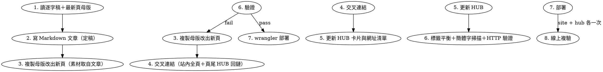

# PUMA 文章 → 靜態網頁 → HUB 索引

## Overview

把一份訪談／座談逐字稿，變成三件互相連結的產物：**Markdown 精華長文**、**共用樣式的靜態網頁**、**HUB 索引頁上的卡片**。

**Core principle:** 沿用既有樣式與慣例，不重新發明 —— 先讀 `site/` 內最新的一頁當母版，改內容不改結構；每一步都驗證，最後一次部署。

**順序不可顛倒（先文章、後網頁）：** 第一件事永遠是把逐字稿寫成 `*_PUMA老師文章.md`。**文章是唯一的內容來源** —— 網頁的 hero、stats、六張論點卡、章節時間碼與逐字稿段落，全部直接從這份 md 取材，不回頭重讀逐字稿再編一次。文章沒定稿就先刻 HTML，會做出兩份互相矛盾的內容。

## When to Use

- 新逐字稿 → 「PUMA 老師文章」md ＋ Pages 網頁
- 已完成的文章要掛上 HUB（`puma-hub.pages.dev`）
- 修改任何 PUMA 站的頁尾、導覽或 cross-link

**Not for:** 非沈伯洋主題的網站、需要前端框架或建置步驟的專案（本流程是純靜態檔直接部署）。

## 檔案與專案慣例

| 用途 | 位置 |
| :-- | :-- |
| 逐字稿來源 | `C:\心理學\puma\<節目標題>_完整逐字稿.md`（或 `_逐字稿.md`） |
| 文章（Markdown） | `C:\心理學\puma\<逐字稿檔名去掉「_完整逐字稿／_逐字稿」>_PUMA老師文章.md` |
| 文章網頁 | `C:\心理學\puma\site\puma-shen-YYYY-MM-DD.html`（直播／播出日） |
| 既有頁母版 | `site/` 內**日期最新**的那頁（本輪為 `puma-shen-2026-09-23.html`），不要寫死成舊頁 |
| 站內頁面 | `site/index.html` ＋ 每一場的 `puma-shen-*.html`（目前 4 頁，每加一場就多一頁） |
| 共用資產 | `C:\心理學\puma\site\` → 專案 `puma-shen-interview` |
| HUB 頁 | `C:\心理學\puma\hub\index.html` → 專案 `puma-hub` |
| HUB 網址 | `https://puma-hub.pages.dev/` |

**md 檔名實例：** 專訪類 `雙北戰局激辯_國會戰將轉戰首都_專訪沈伯洋_PUMA老師文章.md`；活動／座談類 `不落蒂聯盟X衣衣不捨小隊_沈伯洋出席聯合倡議_PUMA老師文章.md`（逐字稿原名 `【完整公開】…_完整逐字稿.md`，去掉片頭括弧與 `_完整逐字稿` 後補 `_PUMA老師文章`）。

## Workflow



## Phase 1：文章（Markdown）— 一切從這裡開始

**這一步定稿之前，不要開任何 HTML 檔。**

1. 讀逐字稿全文，抽出章節時間碼與核心論點。
2. 寫成**精華長文**，不是逐句改寫：前言 → 十節左右主題式論述（用「一、二、三…」編號，節數 ≈ 網頁章節數 ± 2）→ `## 金句引言` → `## 訪談核心要點彙整` 兩欄表格 → `## 一句話總結`。
3. 前言固定兩段：第一段寫場景（時間、地點、台上有誰），第二段寫「這篇把它拆成幾個主題」，讓讀者知道結構。
4. 開頭固定為：

```markdown
# <主標，含一句金句或問題> — 專訪沈伯洋

> **PUMA 老師文章｜訪談精華長文**

* **影片連結**：[節目名 — 標題](https://youtu.be/XXXX)
* **發布日期**：YYYY 年 M 月 D 日／**主持人**／**受訪來賓**／**訪談時長**
```

活動／倡議類（無固定主持人）時，第四列拆成兩列並補地點：

```markdown
* **發布日期**：YYYY 年 M 月 D 日／**主持人**：活動主持人（頻道 LIVE 直播）／**受訪來賓**：…／**訪談時長**：MM 分 SS 秒
* **活動名稱**：…／**地點**：…
```

**紀律：** 數字、人名、引言一律回查逐字稿；政治性論述用「沈伯洋認為／他指出」歸因給受訪者，不寫成既定事實；逐字稿裡彼此矛盾的資訊（例如同一人被介紹成兩個職稱）直接略過不寫，不要自己仲裁；沒把握的地名／專有名詞寧可寫寬一點（「前往日本交流」），也不要猜。

**定稿前自查（兩個實際犯過的錯）：**
- 重複字：「會會流入」「的的」這類疊字，讀一遍再交。
- **簡體字混入**：模型輸出常在中文裡掉進簡體（如「太阳」「这里」），md 與 HTML 都要掃（見 Phase 5 的指令）。

## Phase 2：網頁

1. `Copy-Item` **日期最新的那頁**（本輪 `puma-shen-2026-09-23.html`）→ `puma-shen-YYYY-MM-DD.html`，只換內容。最新頁已是最精簡的結構、nav 已含所有舊頁入口；舊頁（04-12）區塊龐大，只適合當段落參考。
2. **內容一律取自 Phase 1 定稿的 md**：hero 的金句與 `hero__sub`＝前言濃縮；`.stats` 4 格＝文章裡最有份量的四組數字；六張論點卡＝六個小節標題＋一段；`.timeline` 的 stop 數＝章節時間碼數；`.turn` 內文＝該節的引言與段落。
3. 固定區塊順序：`topbar` → `hero`（kicker／h1／`hero__sub`／chips 4 個／actions）→ `stats`（4 格）→ `01 訪談路線`（`.timeline` ＋ N 章節）→ `02 六大論點`（`.cards` 6 張）→ `.banner` 金句 → `03 完整逐字稿`（`.chapters` ＋ `.toc` ＋ `.turn`）→ `MORE`／`cta` → `footer`。
4. **只用 `styles.css` 已存在的 class**；確需新樣式只在檔案尾端追加，不改既有規則。
5. `head` 必須換：`<title>`、`description`、`og:title`、`og:description`、`og:locale`。
6. 對話 turn 的寫法（`styles.css` 內可用的變體與 avatar 單字）：

| 變體 | 顏色 | 用在 |
| :-- | :-- | :-- |
| `turn--shen` | 綠 | 沈伯洋（avatar「沈」） |
| `turn--host` | 紫 | 主持人／串場（「主」） |
| `turn--people` | 灰藍 | 記者、立委、貴賓、群眾（「記」「吳」「張」） |
| `turn--runner` | 青 | 甲隊／第一位兒少代表（「蒂」「兒」） |
| `turn--boss` | 琥珀 | 乙隊／第二位兒少代表（「衣」） |

```html
<div class="turn turn--shen"><div class="turn__avatar">沈</div><div class="turn__body"><div class="turn__who">沈伯洋</div><p>內文</p></div></div>
```

7. **殘留掃描**：存檔前搜尋母版帶過來的舊 YouTube 短網址、舊片長、舊日期、舊主標（例如 `e5_ppHD0QkQ`、`14:32`），全部換掉；`MORE` 卡片則改指向其他舊頁。

## Phase 3：交叉連結（不可漏）

- **頁尾 HUB 回鏈是每一頁的硬性項目**（`site/` 內所有頁，不是只有兩頁）：
  `<div style="margin-top:0.5rem"><a href="https://puma-hub.pages.dev/">📚 回到 PUMA HUB 索引</a></div>`
- **站內互鏈要改「全部舊頁」**：每新增一頁，就把 `index.html` 與每一張舊的 `puma-shen-*.html` 各改兩處 —— `topnav` 加 `<a href="puma-shen-YYYY-MM-DD.html">短標</a>`、`footer` 加一條「另一場：… →」。漏改哪一頁，那一頁的讀者就走不到新文章。
- 新頁自己的 `topnav`／`footer` 也要回指所有舊頁。
- HUB 卡片的「前往閱讀 →」用**絕對網址**（HUB 與文章不同網域，相對路徑會斷）。

## Phase 4：更新 HUB（`puma/hub/index.html`）

1. 依性質放進對應分區：`#featured`（本區）／`#talks`（深度專訪）／`#sessions`（公開座談）。
2. 新卡片複製既有 `.card` 結構：`.card__meta` 放 節目／主持人／日期／時長。
3. `.linklist` 清單追加一列 `<li>`（`①②③…` 順序排）。
4. **同步更新數字**：hero chips 的「收錄 N 篇」「時間跨度」、`.stats` 四格、`ALL LINKS` 的「N 個入口，分屬 M 個專案」、各節 `sec-desc` 的「N 場公開座談」、footer 的「收錄 N 篇」，以及 `<title>`／`og:description` 裡的「七篇／八篇」。改了連結卻沒改數字是最常見的失誤。

## Phase 5：驗證（部署前必做）

**PowerShell `Get-Content` 預設不是 UTF-8，會把中文讀壞、讓標籤數字全部失真。** 一律用：

```powershell
foreach($f in @($newPage, $hubPage)){
  $t=[System.IO.File]::ReadAllText($f,[System.Text.Encoding]::UTF8)
  foreach($tag in @('div','section','header','nav','footer','article','ul','li','p','a')){
    $o=[regex]::Matches($t,"<$tag\b").Count; $c=[regex]::Matches($t,"</$tag>").Count
    if($o -ne $c){ Write-Output "MISMATCH $f <$tag> $o vs </$tag> $c" }
  }
}
```

輸出只有 `check done` 才算過（開閉標籤數不等＝有漏關）。

**簡體字／殘留掃描（md 與所有改過的 HTML 都要跑）：** 模型輸出會在中文裡掉進簡體字，母版殘留則是舊短網址／舊片長。

```powershell
foreach($f in @($md, $newPage, $hubPage)){
  $t=[System.IO.File]::ReadAllText($f,[System.Text.Encoding]::UTF8)
  if($t -match '[这说发学国为从东车门关头见让样气风]'){ Write-Output "SIMPLIFIED $f" }
}
# 殘留檢查：新頁不能出現「上一頁」的 YouTube id、片長、舊日期
$stale=[System.IO.File]::ReadAllText($newPage,[System.Text.Encoding]::UTF8)
foreach($s in @('<上一頁的 yt id>','<上一頁片長>')){ if($stale.Contains($s)){ Write-Output "STALE $newPage -> $s" } }
```

無輸出才算過：`SIMPLIFIED`＝混入簡體字（本輪實際抓到「太阳」），`STALE`＝母版帶來的舊連結／舊片長沒換掉（本輪母版是 `e5_ppHD0QkQ` / `14:32`）。

## Phase 6：部署

```powershell
$d='C:\Users\u8901006\nodejs-portable\node-v22.23.3-win-x64'
$env:Path="$d;$env:Path"          # node/npm 不在 PATH，必須先補
Set-Location 'C:\心理學\puma'      # .wrangler cache 在這個 cwd
& wrangler.cmd whoami              # 確認 pages write 權限
& wrangler.cmd pages deploy site --project-name=puma-shen-interview --branch=main --commit-dirty=true
& wrangler.cmd pages deploy hub   --project-name=puma-hub          --branch=main --commit-dirty=true
```

新專案才需要：`& wrangler.cmd pages project create <name> --production-branch=main`

## Phase 7：線上複驗

```powershell
$base='https://puma-shen-interview.pages.dev'
$r=Invoke-WebRequest -UseBasicParsing -Uri "$base/puma-shen-YYYY-MM-DD"   # 去 .html，否則被 308 擋下
$r.StatusCode; $r.Content.Contains('<關鍵字串>')
# 其餘受改頁也各驗一次（首頁與舊頁應含新頁連結）
$r2=Invoke-WebRequest -UseBasicParsing -Uri 'https://puma-hub.pages.dev/'
$r2.StatusCode; $r2.Content.Contains('puma-shen-YYYY-MM-DD')   # 新舊連結都要出現
```

回報時列出：新建檔、修改檔、正式網址、驗證結果。

## Common Mistakes

| 錯誤 | 修正 |
| :-- | :-- |
| 文章還沒定稿就先刻 HTML | Phase 1 是硬門檻：md 定稿 → 網頁素材全部從 md 取，否則兩份內容會打架 |
| 母版寫死成某個舊頁 | 母版永遠取 `site/` 內**日期最新**的頁；本輪是 `puma-shen-2026-09-23.html` |
| 只改「上次改過的那兩頁」互鏈 | 站內頁數會一直增加，每加一頁就把 `index.html` 與**每一張**舊頁的 topnav＋footer 都補上 |
| `wrangler pages deploy --production-branch=main` 報 Unknown arguments | `deploy` 沒有這個旗標，只用 `--branch=main`；`--production-branch` 只屬於 `project create` |
| 用 `Get-Content` 算 HTML 標籤數 | 讀成 ANSI 會多算 `<div`，改用 `[System.IO.File]::ReadAllText($f, UTF8)` |
| 忘了頁尾 HUB 回鏈 | Phase 3 是硬性項目，`site/` **每一頁**都要有 |
| HUB 卡片加了，數字沒改 | Phase 4 第 4 點：N 篇、時間跨度、入口數、`<title>` 要同步 |
| HUB 用相對路徑連文章 | 跨網域一律絕對網址 |
| 每次從零設計版面 | 先讀母版複製再改，樣式永遠共用 `styles.css` |
| 輸出混入簡體字 | Phase 5 的 `SIMPLIFIED` 掃描：md 與 HTML 都跑，抓到就改回繁體 |
| 部署到 preview 分支 | `--branch=main` 才會進 production |
| 對外連結寫成 `…/xxx.html` | Pages 對 `*.html` 與 `/index.html` 一律回 **308** 轉到乾淨網址（`…/xxx`、`/`）。對外公布的連結**與 Phase 7 的驗證網址**都用去副檔名的網址，否則 PowerShell 這類不追 308 的用戶端會直接失敗 |
| 把站內相對連結也改成乾淨網址 | 不要。`href="index.html"`／`href="xxx.html"` 留著：瀏覽器會追轉址，而且本地直接開檔也仍有效（改掉會斷） |
